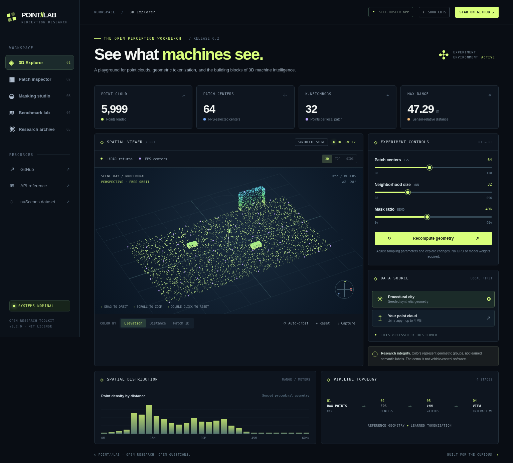
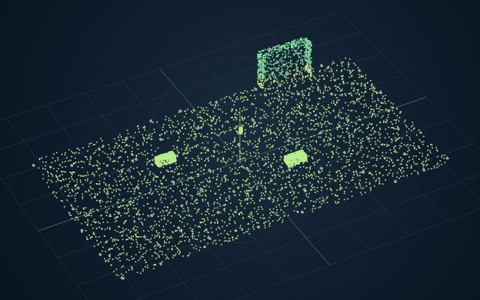
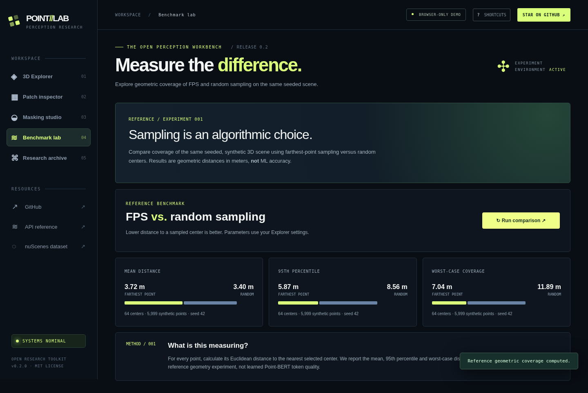

<div align="center">

# POINT//LAB

### See what machines see.

**An open, interactive research playground for LiDAR geometry, Point-BERT-inspired point-cloud pretraining, and reproducible 3D perception experiments.**

Explore the math. Rotate the scene. Mask the patches. Test the assumptions. Fork the lab.

[Explore the browser demo](#instant-demo-on-github-pages) · [Run locally](#run-locally-in-60-seconds) · [Research evidence](#whats-real-whats-experimental) · [Make your first contribution](CONTRIBUTING.md)





<sub>Screenshot: synthetic geometry generated procedurally. No nuScenes samples, learned codebook labels, or pretrained model scores are shown.</sub>

</div>

---

## Why this exists

Most 3D learning papers show a pipeline diagram, a loss function, and a benchmark table. It's harder to **see why a local patch was chosen**, **what the masking objective is actually masking**, or **how far a sampling strategy leaves some points from every center**.

POINT//LAB is an **educational research workbench** built from three autonomous-perception notebooks. The first working release gives you a research-grade reference implementation of FPS + kNN, a beautiful point-cloud explorer, a fair **geometric** sampling comparison, and a transparent record of what the original experiments did and did not establish.

**This is not a new SOTA paper, a trained Point-BERT release, or an autonomous-driving control system.** See [research provenance](docs/RESEARCH_NOTES.md).

## What you can do today

| Experience | What you can try | Runs without a GPU? |
|---|---|---|
| **3D Explorer** | Orbit / zoom live point-cloud data, change height / distance / patch colors, export screenshots | ✅ |
| **Patch Inspector** | Pick geometric FPS centers and inspect their nearest-center regions | ✅ |
| **Masking Studio** | Visually hide a controllable fraction of geometric patches (simulated, not inference) | ✅ |
| **Benchmark Lab** | Compare FPS vs random centers using mean / p95 / worst-case nearest-center distance | ✅ |
| **Real-file uploads** | Open nuScenes `.bin` (5 `float32` channels) or `.npy` (`N×3/4/5`) in the local app | ✅ |
| **Research archive** | Inspect original Point-BERT and RGB-pretraining notebooks with execution provenance | See notebook requirements |

### The benchmark doesn't hide inconvenient results

Reference run (seed 42; 5,999 **synthetic** points; 64 sample centers):

| Nearest sampled center | FPS | Random | Interpretation |
|---|---:|---:|---|
| Mean distance | 3.49 m | **3.39 m** | Random is slightly better *on this measure, on this scene* |
| 95th percentile | **5.56 m** | 8.79 m | FPS improves tail coverage here |
| Worst case | **6.83 m** | 15.67 m | FPS reduces the largest uncovered radius here |

These are **geometric distances**, not learned semantic quality, segmentation accuracy, safety scores, or performance guarantees. The benchmark uses a seeded synthetic scene; numbers change with settings. Local wall-clock timing depends on your machine and is not cross-device comparable.



## Instant demo on GitHub Pages

The repo includes a **browser-only build** in [`docs/site/`](docs/site/) so visitors can explore the geometry without an account, key, dataset download, GPU or backend.

**Once this repository is published**, enable **Settings → Pages → GitHub Actions**. The included [`deploy-demo.yml`](.github/workflows/deploy-demo.yml) publishes the static build automatically. Your resulting project page will have the form:

`https://<YOUR_USERNAME>.github.io/<YOUR_REPO>/`

Use [`docs/media/social-preview.png`](docs/media/social-preview.png) as the GitHub repository social preview in **Settings → General → Social preview**.

The static demo uses a fixed procedural point cloud and recomputes FPS, assignments and benchmark distances in JavaScript. **Static-demo uploads are disabled**; use the self-hosted Python app for real files. Neither mode uses telemetry or requires account sign-in.

## Run locally in 60 seconds

Requirements: Python 3.10+ and Git. macOS, Linux or Windows (PowerShell activation shown separately).

```bash
git clone https://github.com/<YOUR_USERNAME>/pointlab.git
cd pointlab
python -m venv .venv
source .venv/bin/activate           # Windows: .venv\Scripts\Activate.ps1
pip install -e '.[test]'
uvicorn lidar_lab.api:app --reload
```

Open **http://127.0.0.1:8000**. Use the default procedural scene immediately. The server provides OpenAPI docs at [`/docs`](http://127.0.0.1:8000/docs).

> The GitHub URL above is a template; replace `<YOUR_USERNAME>` with your account after publishing. This archive does not imply that the repository is already online.

Docker:

```bash
docker build -t pointlab .
docker run --rm -p 8000:8000 pointlab
```

Test suite and experiments:

```bash
pytest -q
python -m lidar_lab.cli --groups 64 --neighbors 32 --seed 42
python scripts/benchmark_geometry.py --seed 42 --groups 64 --out artifacts/coverage.json
PYTHONPATH=src python scripts/build_static_site.py
```

### Load real nuScenes LiDAR

The local app accepts user-provided `.bin` and `.npy` files, limited to **4 MiB**. For nuScenes, choose one `samples/LIDAR_TOP/*.bin` point cloud. It contains five `float32` values per point, but only XYZ are displayed. No dataset is bundled or downloaded automatically.

The **nuScenes dataset is free strictly for noncommercial use** under its own terms. Register and obtain a copy from [nuScenes](https://www.nuscenes.org/). Do not publish the dataset in this repository. The local API does not persist uploaded files.

## Architecture

```text
                                       ┌──────────────────────────┐
                            ┌───────── │ Browser-only GitHub Pages│
                            │          │ fixed synthetic scene    │
                            │          └──────────────────────────┘
                            │
      [Synthetic XYZ] ───────┤
                            │          ┌──────────────────────────────┐
      [nuScenes .bin] ───────┴───────── │ FastAPI: validate & subsample│
      [NumPy .npy]                      └──────────────┬───────────────┘
                                                      │
                                              ┌───────▼───────┐
                                              │  FPS centers  │
                                              └───────┬───────┘
                                              ┌───────▼───────┐
                                              │kNN neighborhoods│
                                              └───────┬───────┘
                                              ┌───────▼───────┐
                                              │3D canvas / API│
                                              └───────────────┘

  Original research notebooks (kept separate; no model weights bundled):
  LiDAR: Point groups → DGCNN/dVAE → discrete tokens → masked Transformer
  RGB: Image patches → masked ViT-like encoder → reconstruction
```

See [architecture notes](docs/ARCHITECTURE.md) for algorithms, complexity, data formats, limitations and extension points.

## What's real, what's experimental

| Artifact | Evidence in uploaded notebooks | Not claimed |
|---|---|---|
| `pointbert_lidar_tokenization_plotly.ipynb` | FPS/kNN & 3D plotting code | Learned token IDs; only simulated patch/token colors |
| `pointbert_nuscenes_full_visual.ipynb` | Point-BERT-inspired dVAE / masked Transformer code & shape smoke test | Completed pretrained weights or final segmentation results |
| `omnivec2_rgb_pretraining.ipynb` | RGB pretraining code and partial training logs through epoch 15 | 100 completed epochs, production fusion, or future-scene forecasting |
| `src/lidar_lab/` | Deterministic reference geometry + validated API + automated tests | ML semantic inference or autonomous vehicle capability |

A complete source-by-source [provenance audit](docs/RESEARCH_NOTES.md) is included. The RGB and LiDAR experiments are **separate branches**, not an evaluated multimodal fusion network.

## API

| HTTP | Route | Purpose |
|---|---|---|
| `GET` | `/api/health` | Readiness + model-loaded flag |
| `GET` | `/api/scene/demo?seed=42&groups=64&neighbors=32` | Synthetic XYZ + geometric patches |
| `POST` | `/api/scene/upload?groups=64&neighbors=32` | Read local `.bin` or `.npy`, no persistent storage |
| `GET` | `/api/benchmark/demo?seed=42&groups=64` | FPS vs random sampling coverage |
| `GET` | `/docs` | Interactive OpenAPI documentation |

API details and limits: [Architecture → Interface contract](docs/ARCHITECTURE.md).

## Fork it. Break it. Improve it.

We deliberately made the math inspectable and the launch friction low. Some useful starter contributions:

- Add **voxel-grid** and **Poisson-disk** sampling as benchmark methods, with tests.
- Add accurate **nuScenes lidarseg** class-color rendering (with careful point-label alignment).
- Make a **GPU/CUDA** accelerated FPS implementation and compare *end-to-end* performance fairly.
- Add a **temporal two-frame viewer** with ego-pose transforms and timestamp alignment.
- Add **model checkpoint support** that differentiates learned tokens from geometric patches.
- Improve keyboard navigation, accessibility, small-screen interactions, and benchmark visualizations.

Start with [CONTRIBUTING.md](CONTRIBUTING.md). Please do not submit raw licensed nuScenes assets or inaccurate research metrics in PRs.

## Paper references, licensing and responsible use

- [Point-BERT (Yu et al., CVPR 2022)](https://openaccess.thecvf.com/content/CVPR2022/html/Yu_Point-BERT_Pre-Training_3D_Point_Cloud_Transformers_With_Masked_Point_Modeling_CVPR_2022_paper.html). This project is independently implemented for educational exploration, **not** an official Point-BERT repository.
- [nuScenes: A Multimodal Dataset for Autonomous Driving](https://www.nuscenes.org/), licensed separately and **not redistributed**.
- Original OmniVec2-inspired notebook is preserved. See research provenance; model-paper terminology is credited rather than asserting a reproduced official implementation.

Project source code: **MIT** ([LICENSE](LICENSE)). Dataset and third-party models **retain their own terms**. Research code is **not safety certified and must never control a vehicle**.

**Project by Parvathi Nalla**, adapted from exploratory autonomous perception research notebooks. This is a personal open-source project, not an official University of Florida, Point-BERT, or nuScenes release.

<div align="center"><br><strong>If this helped you understand 3D perception, give it a star, share an experiment, or open your first PR.</strong><br><sub>Open models are useful. Open understanding is better.</sub></div>
